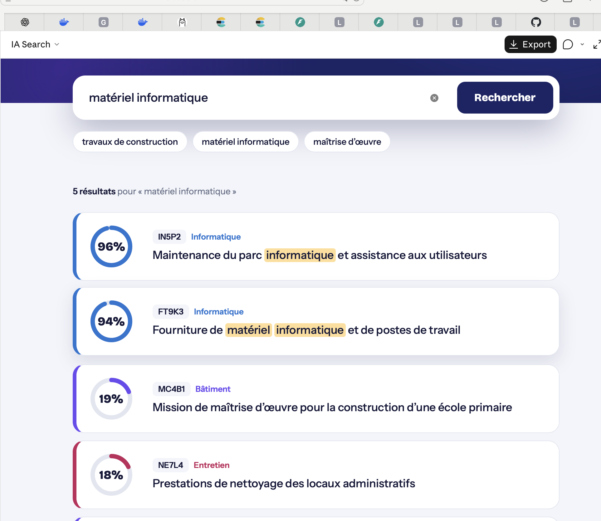

# IA Search

Moteur de recherche IA : embeddings (Ollama), clusters (K-means),
recherche hybride kNN + BM25 (ElasticSearch), rerank par LLM.

## Prérequis
- Docker Desktop
- Ollama installé sur la machine, avec les modèles :
  - `ollama pull qwen3-embedding:0.6b`
  - `ollama pull qwen3.5:0.8b`
- uv (pour le script d'indexation)

## Lancement
1. `docker compose up -d elasticsearch backend front`
   (le backend joint Ollama via `host.docker.internal:11434`)
2. Indexer les données :
   `cd index_data && uv run main.py`
3. Ouvrir http://localhost:3000

## Architecture
- `index_data/` : script d'indexation (embeddings, K-means, ElasticSearch)
- `fastapi-backend/` : API de recherche (kNN sur les clusters, hybride dans le cluster, rerank)
- `react-front/` : interface React
- `docker-compose.yml` : ElasticSearch, Ollama, backend, front

## Version 2
Une version améliorée (recherche multi-clusters, nouvelle interface, Ollama dans le compose) se trouve dans le dossier [`v2/`](./v2). Voir `v2/README.md`.

## Aperçu (v1)

## Remarque sur Ollama et le docker compose
Dans cette version, le fichier `docker-compose.yml` contient un service `ollama`, mais le backend utilise l'Ollama installé directement sur la machine, à l'adresse `host.docker.internal:11434`. Le conteneur `ollama` et l'application Ollama utilisent le même port (11434) : il ne faut donc pas lancer les deux en même temps. C'est pourquoi la commande de lancement ne démarre que `elasticsearch`, `backend` et `front`.

Cette contrainte vient de mon environnement de développement : sur Mac, Docker n'a pas accès au GPU, et le téléchargement des modèles dans le conteneur échouait au départ.

**La version où tout tourne dans le docker compose, y compris Ollama, est dans le dossier [`v2/`](./v2).**

## Données
Cette version indexe le jeu de données du TD (lien pCloud, environ 1000 lignes). La version 2 (dossier `v2/`) indexe un échantillon de 2000 lignes tiré du fichier complet `objet_consultations_100000.txt`.
