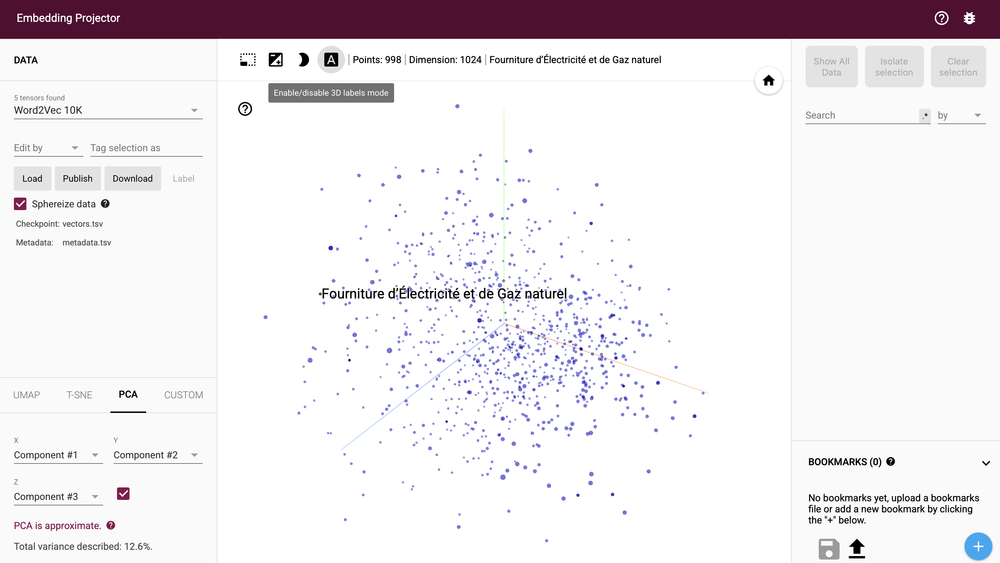
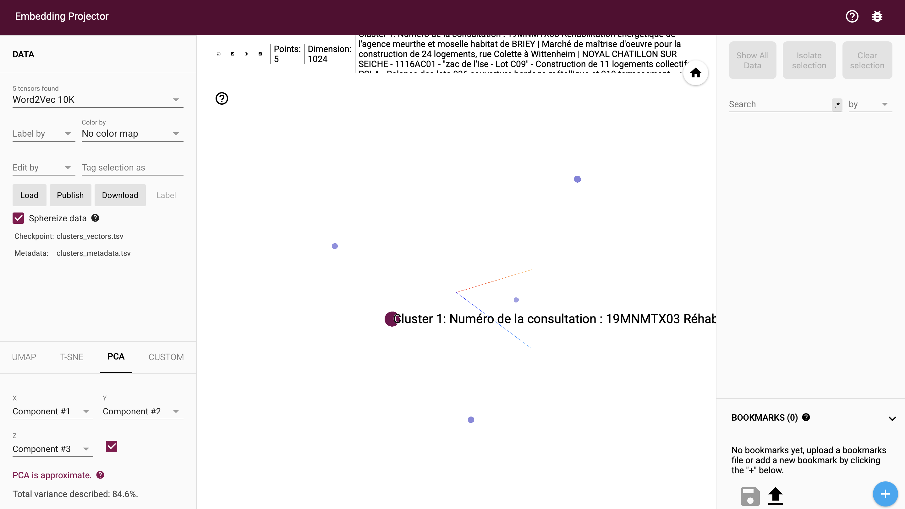

# Exploration des embeddings (TD1-1)

Notebook Google Colab : `exploration_embeddings.ipynb`

1. Téléchargement du jeu de données et calcul des embeddings avec un modèle Hugging Face
2. Export des vecteurs au format TSV
3. K-means en 5 clusters
4. Visualisation sur https://projector.tensorflow.org/ (algorithme UMAP)

