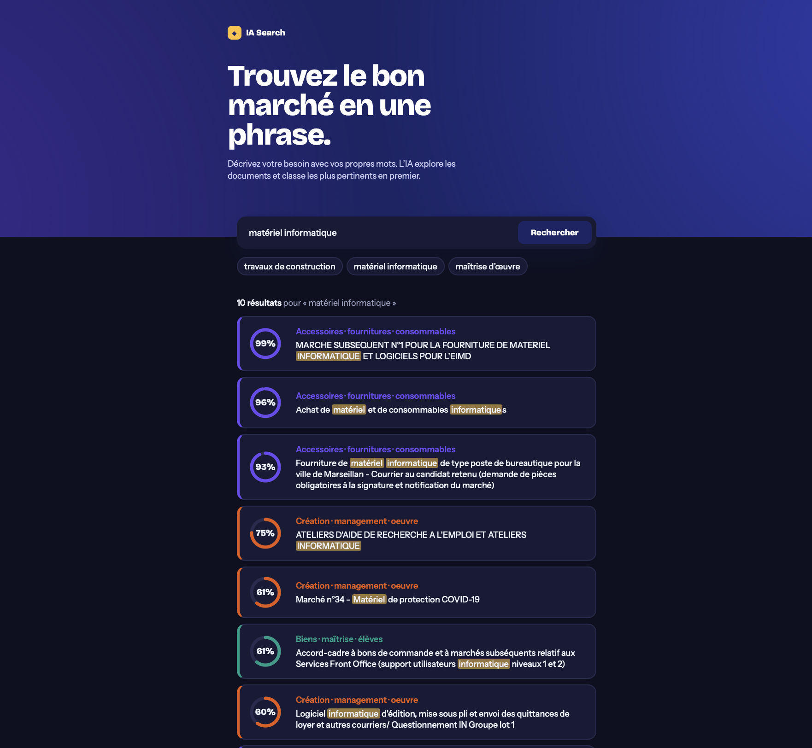

# IA Search v2

Version améliorée de IA Search, sur le même sujet : moteur de recherche sémantique sur des marchés publics.

## Ce qui change par rapport à la v1
- Recherche dans les 3 clusters les plus proches (au lieu d'un seul)
- Rerank en parallèle, modèles gardés en mémoire
- Noms de clusters construits avec les mots les plus caractéristiques de chaque groupe (TF-IDF)
- Nouvelle interface : jauge de pertinence, couleur par groupe, mots surlignés
- Ollama dans le docker compose

## Lancement (depuis le dossier v2)
1. `docker compose up -d --build`
2. `docker compose exec ollama ollama pull qwen3-embedding:0.6b`
3. `docker compose exec ollama ollama pull qwen3.5:0.8b`
4. `cd index_data && uv run main.py`
5. Ouvrir http://localhost:3000

Les ports sont les mêmes que ceux de la v1 : arrêter la v1 avant (`docker compose down` à la racine).

## Remarque
Le rerank appelle le LLM une fois par résultat : c'est le principal poste de latence, surtout sur CPU (Docker sur Mac n'utilise pas le GPU).

## Aperçu

## Points d'attention au premier lancement
- Les volumes Docker sont vides au départ : les deux `ollama pull` et l'indexation (`uv run main.py`) sont indispensables avant la première recherche.
- Si une application Ollama est déjà ouverte sur la machine, la quitter : elle occupe le port 11434 du conteneur.
- Sur une machine avec GPU NVIDIA, le service `ollama` peut en profiter en ajoutant au compose un bloc `deploy.resources.reservations.devices` (driver `nvidia`). Sans GPU (par exemple sur Mac), tout tourne sur le processeur et la recherche est plus lente.
